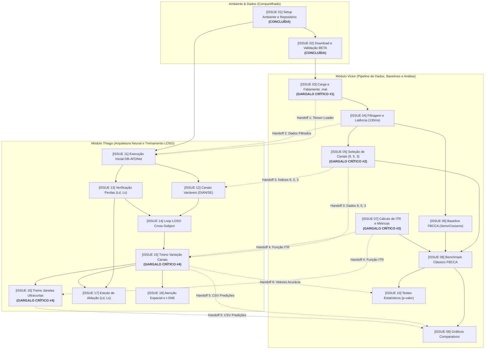

# Planejamento Operacional e Catálogo Detalhado de Issues (01 a 18)

Este documento contém o catálogo completo e padronizado das **18 issues** do projeto para a disciplina **OPT098 - Tópicos Especiais em Sistemas de Computação**.  
Todas as issues foram estruturadas seguindo as **15 características fundamentais de engenharia de software** (História de Usuário, Critérios em Gherkin, Assinaturas de Entrada/Saída, Considerações Técnicas, DoD, Prioridade, Estimativa e Rastreabilidade).

---

## 1. Mapeamento de Dependências e Análise de Caminho Crítico

### Diagrama de Fluxo e Handoffs entre Victor e Thiago



---

### 2. Quadro dos 4 Gargalos Críticos Inter-Módulos (Pontos de Bloqueio)

| Gargalo | Origem $\rightarrow$ Destino | Issues Envolvidas | Impacto se Atrasar | Ação Preventiva Imediata |
| :--- | :--- | :--- | :--- | :--- |
| **Gargalo #1** | **Victor $\rightarrow$ Thiago** | **ISSUE 03** bloqueia **ISSUE 11** | Thiago não consegue alimentar o repositório DB-AFDNet com os dados padronizados do BETA, travando a adaptação neural. | Victor prioriza a Issue 03 imediatamente e fecha o contrato do tensor: `[amostras, canais, tempo]`. |
| **Gargalo #2** | **Victor $\rightarrow$ Thiago** | **ISSUE 04 e 05** bloqueiam **ISSUE 12 e 15** | Thiago não pode parametrizar a entrada da rede com 5 e 3 canais nem rodar o treinamento cross-subject comparativo. | Definir a lista e ordem estrita dos canais: 9 (`Pz, PO5, PO3, POz, PO4, PO6, O1, Oz, O2`), 5 (`POz, PO3, PO4, Oz, O1`) e 3 (`O1, Oz, O2`). |
| **Gargalo #3** | **Victor $\rightarrow$ Thiago** | **ISSUE 07** bloqueia **ISSUE 15 e 16** | Se o cálculo de ITR for feito de formas divergentes, as comparações do artigo final serão estatisticamente inválidas. | Victor implementa `compute_itr(...)` em `src/utils/metrics.py` com testes unitários compartilhados antes da Issue 15. |
| **Gargalo #4** | **Thiago $\rightarrow$ Victor** | **ISSUE 15 e 16** bloqueiam **ISSUE 09 e 10** | Victor fica de mãos atadas para produzir os gráficos finais (barras de ITR vs. canais) e os testes $t$ pareados para o artigo. | Thiago exporta os resultados consolidados em `experiments/results/` seguindo um formato padronizado de CSV (`sujeito, canais, janela, acuracia, itr`). |

---

## 3. Catálogo Detalhado das 18 Issues

---

### [ISSUE 01] [Setup/Env]: Configuração do repositório, ambiente virtual e dependências base `[CONCLUÍDA]`

1. **Título:** `[Setup/Env]: Configuração da infraestrutura do repositório, ambiente virtual Python e dependências científicas`
2. **História de Usuário:**
   > **Como** pesquisador e desenvolvedor do projeto OPT098,  
   > **eu quero** um ambiente de desenvolvimento reproduzível com PyTorch, MNE e SciPy configurados em um ambiente virtual isolado,  
   > **para que** tanto o pipeline de dados quanto o treinamento neural executem sem conflitos de dependências ou divergências de versões.
3. **Critérios de Aceitação (Gherkin):**
   * **Dado que** o repositório foi clonado em um ambiente limpo com Python 3.10+,
   * **Quando** o desenvolvedor criar o `.venv` e executar `pip install -r requirements.txt`,
   * **Então** a execução de `python -c "import torch, scipy, mne; print('OK')"` deve retornar `OK` sem erros de importação.
4. **Exemplo de Requisição (CLI):**
   ```powershell
   python -m venv .venv
   .\.venv\Scripts\Activate.ps1
   pip install -r requirements.txt
   ```
5. **Exemplo de Resposta (Saída Esperada):**
   ```text
   Successfully installed torch-2.14.1 scipy-1.18.1 mne-1.13.2 numpy-2.5.4 pandas-3.0.6
   OK
   ```
6. **Componentes Envolvidos:**
   * Diretórios: `data/`, `src/`, `models/`, `experiments/`, `notebooks/`, `scripts/`
   * Arquivos: `.gitignore`, `requirements.txt`, `README.md`, `scripts/verify_env.py`
7. **Considerações Técnicas e Arquitetura:**
   * Python 3.13 de 64 bits compatível com wheels oficiais do PyTorch (CPU/CUDA).
   * O `.gitignore` deve proibir estritamente o envio de `.venv/`, dados binários `*.mat` e checkpoints de modelo `*.pth`.
8. **Mockups ou Referências Visuais:**
   * Estrutura de árvore de diretórios documentada no `README.md`.
9. **Dependências e Bloqueios:**
   * **Depende de:** Nenhuma (Raiz).
   * **Bloqueia:** ISSUE 02, ISSUE 03, ISSUE 11.
10. **Como Testar (Plano de Teste):**
    ```powershell
    python scripts/verify_env.py
    ```
    * Deve imprimir `[OK]` para PyTorch, SciPy, MNE, NumPy, Pandas, Scikit-Learn e Seaborn.
11. **Definição de Pronto (DoD):**
    * [x] Repositório clonado e versionado no Git.
    * [x] Arquivo `.gitignore` ativo e testado.
    * [x] Script de verificação automatizado criado e com saída zero.
12. **Prioridade e Severidade:** Prioridade P1 (Máxima) | Severidade Crítica.
13. **Etiquetas (Labels):** `setup`, `infrastructure`, `python`, `shared`.
14. **Documentação Relacionada:** [README.md](file:///c:/Users/victor/Documents/GitHub/OPT098/README.md).
15. **Estimativa:** P (1 Story Point).

---

### [ISSUE 02] [Data/Ingestion]: Download e validação da integridade de amostras do dataset BETA `[CONCLUÍDA]`

1. **Título:** `[Data/Ingestion]: Download automatizado e auditoria de integridade dos tensores do dataset BETA`
2. **História de Usuário:**
   > **Como** cientista de dados de BCI,  
   > **eu quero** baixar os arquivos `.mat` do dataset BETA diretamente do repositório público do Figshare,  
   > **para que** tenhamos dados brutos consistentes de pelo menos 10 sujeitos prontos para o pipeline sem corrupções.
3. **Critérios de Aceitação (Gherkin):**
   * **Dado que** o script de download acessa a API do Figshare (Artigo 12264401),
   * **Quando** o download for executado para os voluntários `S1` a `S10`,
   * **Então** os arquivos devem estar salvos em `data/raw/` e a validação deve confirmar tensores com shape `(64, 750, 4, 40)` livres de `NaN` ou `Inf`.
4. **Exemplo de Requisição (CLI):**
   ```powershell
   python scripts/download_beta.py --num-subjects 10
   python scripts/verify_beta_data.py
   ```
5. **Exemplo de Resposta (Saída Esperada):**
   ```text
   S1.mat : PASSED | Tensor Shape: (64, 750, 4, 40)
   ...
   S10.mat : PASSED | Tensor Shape: (64, 750, 4, 40)
   >>> All downloaded BETA subject files are valid and ready for pipeline processing! <<<
   ```
6. **Componentes Envolvidos:**
   * Scripts: `scripts/download_beta.py`, `scripts/verify_beta_data.py`
   * Armazenamento: `data/raw/S*.mat`, `data/raw/Description.pdf`, `data/raw/note.txt`
7. **Considerações Técnicas e Arquitetura:**
   * Taxa de amostragem: $f_s = 250$ Hz; Duração da época bruta: $3,0$ s ($750$ pontos).
   * Alvos: 40 classes (8,0 a 15,8 Hz em passos de 0,2 Hz).
   * Bloco: 4 blocos de teste por voluntário.
8. **Mockups ou Referências Visuais:**
   * Diagrama da montagem internacional 10-20 contido no `Description.pdf`.
9. **Dependências e Bloqueios:**
   * **Depende de:** ISSUE 01.
   * **Bloqueia:** ISSUE 03 (Gargalo Crítico #1).
10. **Como Testar (Plano de Teste):**
    ```powershell
    python scripts/verify_beta_data.py
    ```
    * Retorno deve ter código de saída 0 e confirmar ausência de NaNs.
11. **Definição de Pronto (DoD):**
    * [x] Download automatizado com barra de progresso.
    * [x] Sujeitos S1 a S10 presentes localmente.
    * [x] Validação dimensional e semântica aprovada.
12. **Prioridade e Severidade:** Prioridade P1 (Máxima) | Severidade Crítica.
13. **Etiquetas (Labels):** `data-pipeline`, `eeg`, `dataset-beta`, `shared`.
14. **Documentação Relacionada:** Liu et al. (2020), Frontiers in Neuroscience (DOI: 10.6084/m9.figshare.12264401).
15. **Estimativa:** M (3 Story Points).

---

### [ISSUE 03] [Data/Loader]: Implementação do módulo de carregamento e fatiamento dos arquivos `.mat`

1. **Título:** `[Data/Loader]: Implementação do carregador de matrizes .mat com segmentação flexível de épocas`
2. **História de Usuário:**
   > **Como** desenvolvedor responsável pelo pipeline de dados (Victor),  
   > **eu quero** expor a função `load_subject_data(subject_id, window_length, ...)` em `src/data/loader.py`,  
   > **para que** o baseline clássico e o repositório neural (Thiago) consumam tensores NumPy uniformemente formatados.
3. **Critérios de Aceitação (Gherkin):**
   * **Dado que** o arquivo `S{id}.mat` existe em `data/raw/`,
   * **Quando** `load_subject_data(subject_id=1, window_length=1.0)` for chamado,
   * **Então** deve retornar uma tupla `(X, y)` onde `X` é um `ndarray` de float32 `[160, 64, 250]` (160 tentativas = 4 blocos $\times$ 40 alvos) e `y` são os rótulos de classe inteiros `[0..39]`.
4. **Exemplo de Requisição (Python API):**
   ```python
   from src.data.loader import load_subject_data
   X, y = load_subject_data(subject_id=1, window_length=1.0)
   ```
5. **Exemplo de Resposta (Saída Esperada):**
   ```python
   # X.shape -> (160, 64, 250), dtype -> float32
   # y.shape -> (160,), dtype -> int64 (valores de 0 a 39)
   ```
6. **Componentes Envolvidos:**
   * Código: `src/data/loader.py`, `tests/test_loader.py`
7. **Considerações Técnicas e Arquitetura:**
   * Utilizar `scipy.io.loadmat(..., squeeze_me=False)`.
   * Acesso à chave `data['EEG'][0, 0]` estruturada em `(64, 750, 4, 40)`.
   * Realizar transposições para alinhar na dimensão padrão de Machine Learning: `[N_amostras, Canais, Tempo]`.
8. **Mockups ou Referências Visuais:**
   * Diagrama temporal: `| Pre-estímulo (0.5s) | Estímulo (2.0s) | Pós-estímulo (0.5s) |`.
9. **Dependências e Bloqueios:**
   * **Depende de:** ISSUE 02.
   * **Bloqueia:** ISSUE 04, **ISSUE 11 (Gargalo Crítico #1 para o Thiago)**.
10. **Como Testar (Plano de Teste):**
    1. Executar teste unitário instanciando sujeitos 1 e 2 com durações de `0.5` e `1.0` segundos.
    2. Verificar `assert X.shape == (160, 64, int(window_length * 250))`.
    3. Verificar que as classes em `y` possuem distribuição uniforme (4 repetições por alvo).
11. **Definição de Pronto (DoD):**
    * Módulo `src/data/loader.py` implementado com tratamento de exceções (ex: arquivo inexistente).
    * Teste unitário passando sem falhas.
    * Docstrings completas com tipos no formato NumPy/Google.
12. **Prioridade e Severidade:** Prioridade P1 (Máxima) | Severidade Crítica (Gargalo #1).
13. **Etiquetas (Labels):** `data-pipeline`, `loader`, `victor-focus`.
14. **Documentação Relacionada:** `references/DBAFDNet/main.py#L66-L78`.
15. **Estimativa:** M (3 Story Points).

---

### [ISSUE 04] [Data/Preprocessing]: Implementação da filtragem digital e compensação de latência visual

1. **Título:** `[Data/Preprocessing]: Filtros digitais IIR passa-faixa, notch e deslocamento temporal de 130 ms`
2. **História de Usuário:**
   > **Como** pesquisador de processamento de sinais,  
   > **eu quero** aplicar filtros passa-faixa (8–64 Hz), filtro notch (50 Hz) e compensar o atraso do sistema visual (130 ms),  
   > **para que** as harmônicas de SSVEP fiquem evidentes e sem contaminação de ruído de rede elétrica antes da classificação.
3. **Critérios de Aceitação (Gherkin):**
   * **Dado um** tensor temporal contendo sinal EEG bruto amostrado a 250 Hz,
   * **Quando** passar pela função `preprocess_eeg(X, fs=250, l_freq=8.0, h_freq=64.0, latency_ms=130)`,
   * **Então** o sinal de saída deve iniciar 130 ms após o onset do estímulo, com frequências fora de 8–64 Hz e ruído de 50 Hz atenuados em pelo menos 30 dB.
4. **Exemplo de Requisição (Python API):**
   ```python
   from src.data.preprocessing import preprocess_eeg
   X_filt = preprocess_eeg(X_raw, fs=250, l_freq=8.0, h_freq=64.0, notch_freq=50.0, latency_delay_ms=130)
   ```
5. **Exemplo de Resposta (Saída Esperada):**
   ```python
   # X_filt.shape -> (160, 64, N_pontos_janela), valores centralizados em torno de zero
   ```
6. **Componentes Envolvidos:**
   * Código: `src/data/preprocessing.py`, `scipy.signal` (filtros Butterworth ou Chebyshev de fase zero via `sosfiltfilt`).
7. **Considerações Técnicas e Arquitetura:**
   * O deslocamento de 130 ms em 250 Hz equivale a `int(0.13 * 250) = 32` amostras.
   * Pré-estímulo do BETA dura 0,5 s (125 amostras). Ponto de início absoluto: `125 + 32 = 157` amostras.
   * Filtro passa-faixa de 8 Hz a 64 Hz abrange a fundamental e até o 4º harmônico da frequência máxima (15,8 Hz $\times$ 4 = 63,2 Hz).
8. **Mockups ou Referências Visuais:**
   * Gráfico de densidade espectral de potência (PSD) demonstrando queda em 50 Hz e nas bordas da banda.
9. **Dependências e Bloqueios:**
   * **Depende de:** ISSUE 03.
   * **Bloqueia:** ISSUE 05, ISSUE 06, ISSUE 11.
10. **Como Testar (Plano de Teste):**
    1. Gerar sinal sintético de teste com senóide de 10 Hz + ruído de 50 Hz + drift de 1 Hz.
    2. Aplicar `preprocess_eeg`.
    3. Fazer FFT e verificar atenuação drástica das componentes de 1 Hz e 50 Hz.
11. **Definição de Pronto (DoD):**
    * Módulo implementado usando `scipy.signal.sosfiltfilt` para distorção de fase zero.
    * Sem memory leaks ao processar lotes grandes de voluntários.
12. **Prioridade e Severidade:** Prioridade P1 | Severidade Alta.
13. **Etiquetas (Labels):** `signal-processing`, `filtering`, `victor-focus`.
14. **Documentação Relacionada:** Liu et al. (2020), Seção 2.1 do PDF de Revisão.
15. **Estimativa:** M (3 Story Points).

---

### [ISSUE 05] [Data/Spatial]: Criação do módulo flexível de seleção de subconjuntos de canais (9, 5 e 3)

1. **Título:** `[Data/Spatial]: Seletor configurável de montagens espaciais parieto-occipitais (9, 5 e 3 eletrodos)`
2. **História de Usuário:**
   > **Como** pesquisador avaliando o impacto da redução de sensores,  
   > **eu quero** filtrar dinamicamente os eletrodos de entrada para 9, 5 ou 3 canais occipitais,  
   > **para que** possamos medir diretamente a perda de acurácia em sistemas BCI compactos.
3. **Critérios de Aceitação (Gherkin):**
   * **Dado um** tensor com 64 canais na montagem padrão BETA,
   * **Quando** `select_channels(X, num_channels=5)` for acionado,
   * **Então** deve retornar um tensor com shape `[amostras, 5, tempo]` contendo exatamente os canais `[POz, PO3, PO4, Oz, O1]`.
4. **Exemplo de Requisição (Python API):**
   ```python
   from src.data.channels import select_channels
   X_9ch = select_channels(X_filt, num_channels=9)
   X_5ch = select_channels(X_filt, num_channels=5)
   X_3ch = select_channels(X_filt, num_channels=3)
   ```
5. **Exemplo de Resposta (Saída Esperada):**
   ```python
   # X_9ch.shape -> (160, 9, 250)
   # X_5ch.shape -> (160, 5, 250)
   # X_3ch.shape -> (160, 3, 250)
   ```
6. **Componentes Envolvidos:**
   * Código: `src/data/channels.py`
7. **Considerações Técnicas e Arquitetura:**
   * Mapeamento de canais (0-indexado do dataset BETA de 64 eletrodos):
     * **9 Canais:** `[47, 53, 54, 55, 56, 57, 60, 61, 62]` $\rightarrow$ `(Pz, PO5, PO3, POz, PO4, PO6, O1, Oz, O2)`
     * **5 Canais:** `[55, 54, 56, 61, 60]` $\rightarrow$ `(POz, PO3, PO4, Oz, O1)`
     * **3 Canais:** `[60, 61, 62]` $\rightarrow$ `(O1, Oz, O2)`
   * O módulo deve suportar tanto passagem por string (`'9ch'`, `'5ch'`, `'3ch'`) quanto lista de nomes de eletrodos.
8. **Mockups ou Referências Visuais:**
   * Esquema de eletrodos no escalpo destacando a região occipital primária.
9. **Dependências e Bloqueios:**
   * **Depende de:** ISSUE 04.
   * **Bloqueia:** ISSUE 08, **ISSUE 12 e ISSUE 15 (Gargalo Crítico #2 para o Thiago)**.
10. **Como Testar (Plano de Teste):**
    1. Criar matriz mock com valores de canal iguais ao índice do eletrodo `[0..63]`.
    2. Chamar `select_channels(mock, num_channels=3)`.
    3. Assegurar que os canais resultantes sejam exatamente 60, 61 e 62.
11. **Definição de Pronto (DoD):**
    * Módulo implementado e documentado com constantes mapeadas.
    * Validação de entrada lançando `ValueError` caso um canal inexistente seja solicitado.
12. **Prioridade e Severidade:** Prioridade P1 (Máxima) | Severidade Crítica (Gargalo #2).
13. **Etiquetas (Labels):** `spatial-filter`, `channels`, `victor-focus`.
14. **Documentação Relacionada:** Seção 4.2 do PDF de Revisão, `references/DBAFDNet/main.py#L51`.
15. **Estimativa:** P (2 Story Points).

---

### [ISSUE 06] [Model/Baseline]: Implementação do classificador baseline FBCCA

1. **Título:** `[Model/Baseline]: Implementação do algoritmo Filter Bank Canonical Correlation Analysis (FBCCA)`
2. **História de Usuário:**
   > **Como** pesquisador de BCI (Victor),  
   > **eu quero** implementar o classificador não supervisionado FBCCA,  
   > **para que** tenhamos uma linha de base clássica consolidada para comparar com o modelo neural sem necessidade de calibração.
3. **Critérios de Aceitação (Gherkin):**
   * **Dado um** bloco de teste com sinais SSVEP de 40 alvos,
   * **Quando** `fbcca.predict(X_epoch)` for executado,
   * **Então** deve retornar o índice da classe predita $[0..39]$ calculando a correlação máxima ponderada entre sub-bandas e gabaritos harmônicos.
4. **Exemplo de Requisição (Python API):**
   ```python
   from src.models.fbcca import FBCCAClassifier
   fbcca = FBCCAClassifier(target_freqs=frequencies_40, fs=250, n_harmonics=5, n_subbands=3)
   y_pred = fbcca.predict(X_test)
   ```
5. **Exemplo de Resposta (Saída Esperada):**
   ```python
   # y_pred.shape -> (160,), dtype -> int64
   # Matriz de correlações com dimensões [160, 40]
   ```
6. **Componentes Envolvidos:**
   * Código: `src/models/fbcca.py`, `scipy.signal`, `sklearn.cross_decomposition.CCA` (ou implementação acelerada via SVD).
7. **Considerações Técnicas e Arquitetura:**
   * Gabaritos teóricos de referência para cada frequência $f_k$:
     $Y_k(t) = [\sin(2\pi \cdot h \cdot f_k \cdot t), \cos(2\pi \cdot h \cdot f_k \cdot t)]^T$ para $h=1, \dots, N_h$.
   * Pesos das sub-bandas de filtros harmônicos: $w(n) = n^{-a} + b$ (padrão da literatura: $a=1.25, b=0.25$).
   * Combinação ponderada de coeficientes: $\rho_k = \sum_{n=1}^G w(n) (\rho_{n, k})^2$.
8. **Mockups ou Referências Visuais:**
   * Diagrama esquemático do banco de filtros harmônicos se dividindo em 3 sub-bandas (8-64 Hz, 16-64 Hz, 24-64 Hz).
9. **Dependências e Bloqueios:**
   * **Depende de:** ISSUE 04.
   * **Bloqueia:** ISSUE 08.
10. **Como Testar (Plano de Teste):**
    1. Criar um sinal senoidal puro em 10.0 Hz.
    2. Alimentar no FBCCA configurado com alvos incluindo 10.0 Hz.
    3. Assert `fbcca.predict(mock_signal) == target_index_of_10Hz`.
11. **Definição de Pronto (DoD):**
    * Classe FBCCA compatível com a interface do Scikit-Learn (`fit` e `predict`).
    * Implementação vetorizada para execução rápida (inferência < 10 ms por época).
12. **Prioridade e Severidade:** Prioridade P2 (Alta) | Severidade Alta.
13. **Etiquetas (Labels):** `baseline`, `fbcca`, `unsupervised`, `victor-focus`.
14. **Documentação Relacionada:** Chen et al. (2015), Seção 3 da Tabela 1 do PDF de Revisão.
15. **Estimativa:** G (5 Story Points).

---

### [ISSUE 07] [Utils/Metrics]: Implementação do cálculo da Taxa de Transferência de Informação (ITR) e métricas

1. **Título:** `[Utils/Metrics]: Implementação padronizada do cálculo de ITR (bits/min), acurácia e estatísticas`
2. **História de Usuário:**
   > **Como** membro da equipe,  
   > **eu quero** uma biblioteca compartilhada em `src/utils/metrics.py` com a fórmula exata de ITR,  
   > **para que** tanto os baselines quanto os modelos neurais meçam a velocidade de comunicação sob os mesmos critérios.
3. **Critérios de Aceitação (Gherkin):**
   * **Dada uma** acurácia de 90%, janela de 1,0 s, gaze-shift de 0,5 s e 40 alvos,
   * **Quando** `compute_itr(acc=0.90, time_window=1.0, n_targets=40, gaze_shift=0.5)` for invocado,
   * **Então** a função deve retornar o valor teórico de ITR em bits/minuto exato de acordo com a fórmula de Wolpaw.
4. **Exemplo de Requisição (Python API):**
   ```python
   from src.utils.metrics import compute_itr, evaluate_classification
   itr = compute_itr(accuracy=0.84, window_length=1.0, n_classes=40, gaze_shift=0.5)
   metrics = evaluate_classification(y_true, y_pred, window_length=1.0)
   ```
5. **Exemplo de Resposta (Saída Esperada):**
   ```python
   # itr -> 145.26 (float em bits/min)
   # metrics -> {'accuracy': 0.84, 'itr': 145.26, 'f1_macro': 0.835}
   ```
6. **Componentes Envolvidos:**
   * Código: `src/utils/metrics.py`, `tests/test_metrics.py`
7. **Considerações Técnicas e Arquitetura:**
   * Fórmula de Wolpaw:
     $$B = \log_2(N) + P \log_2(P) + (1-P) \log_2\left(\frac{1-P}{N-1}\right)$$
     $$\text{ITR} = B \times \left(\frac{60}{T_{\text{janela}} + T_{\text{gaze}}}\right)$$
   * Tratamento de bordas: para $P = 1.0$ e $P \le \frac{1}{N}$ (limite inferior onde ITR = 0).
8. **Mockups ou Referências Visuais:**
   * Curva teórica de ITR vs. Acurácia para $N=40$.
9. **Dependências e Bloqueios:**
   * **Depende de:** Nenhuma (Independente).
   * **Bloqueia:** ISSUE 08, **ISSUE 15 e ISSUE 16 (Gargalo Crítico #3 para o Thiago)**.
10. **Como Testar (Plano de Teste):**
    ```powershell
    pytest tests/test_metrics.py
    ```
    * Comparar valores calculados com tabelas clássicas da literatura para alvos $N=40$.
11. **Definição de Pronto (DoD):**
    * Módulo implementado e testado para limites ($P=0$, $P=1$).
    * Documentação das unidades de medida (bits/min, segundos).
12. **Prioridade e Severidade:** Prioridade P1 (Máxima) | Severidade Crítica (Gargalo #3).
13. **Etiquetas (Labels):** `metrics`, `itr`, `evaluation`, `shared`.
14. **Documentação Relacionada:** Wolpaw et al. (2002), Seção 3 do PDF de Revisão.
15. **Estimativa:** P (2 Story Points).

---

### [ISSUE 08] [Experiment/Benchmark]: Benchmark clássico: Avaliação do FBCCA variando canais e janelas

1. **Título:** `[Experiment/Benchmark]: Execução do benchmark FBCCA sob variação sistemática de canais e durações temporais`
2. **História de Usuário:**
   > **Como** pesquisador avaliador (Victor),  
   > **eu quero** rodar um script em lote avaliando o FBCCA em 9, 5 e 3 canais e janelas de 0.3s, 0.5s, 0.8s e 1.0s,  
   > **para que** tenhamos a matriz completa de acurácia e ITR do baseline salva em CSV para confrontar com o modelo neural.
3. **Critérios de Aceitação (Gherkin):**
   * **Dado o** conjunto de voluntários baixados (`S1` a `S10`),
   * **Quando** `python -m experiments.run_fbcca_benchmark` finalizar,
   * **Então** deve gerar `experiments/results/fbcca_benchmark.csv` contendo acurácia e ITR por sujeito em todas as 12 combinações experimentais.
4. **Exemplo de Requisição (CLI):**
   ```powershell
   python -m experiments.run_fbcca_benchmark --subjects 1-10 --channels 9,5,3 --windows 0.3,0.5,0.8,1.0
   ```
5. **Exemplo de Resposta (Arquivo CSV de Saída):**
   ```csv
   subject,channels,window_sec,accuracy,itr
   S1,9,1.0,0.875,124.50
   S1,5,1.0,0.825,110.20
   S1,3,1.0,0.725,88.40
   ...
   ```
6. **Componentes Envolvidos:**
   * Scripts: `experiments/run_fbcca_benchmark.py`
   * Saídas: `experiments/results/fbcca_benchmark.csv`, `experiments/logs/fbcca.log`
7. **Considerações Técnicas e Arquitetura:**
   * Execução paralela com `joblib` ou `multiprocessing` por sujeito para agilizar o tempo de execução.
   * Registro detalhado de logs informando tempo de inferência médio por época.
8. **Mockups ou Referências Visuais:**
   * Tabela comparativa com médias e desvios padrão para cada configuração.
9. **Dependências e Bloqueios:**
   * **Depende de:** ISSUE 05, ISSUE 06, ISSUE 07.
   * **Bloqueia:** ISSUE 09, ISSUE 10.
10. **Como Testar (Plano de Teste):**
    1. Rodar benchmark para apenas 1 sujeito (`--subjects 1`).
    2. Verificar integridade das colunas e valores de acurácia no CSV gerado.
11. **Definição de Pronto (DoD):**
    * Script automatizado com argumentos via `argparse`.
    * CSV gerado sem valores nulos e com médias consolidadas.
12. **Prioridade e Severidade:** Prioridade P2 | Severidade Média.
13. **Etiquetas (Labels):** `experiment`, `benchmark`, `fbcca`, `victor-focus`.
14. **Documentação Relacionada:** Seção 4 (Cronograma) do PDF de Revisão.
15. **Estimativa:** M (3 Story Points).

---

### [ISSUE 09] [Visualization/Reports]: Geração de gráficos comparativos e curvas de desempenho

1. **Título:** `[Visualization/Reports]: Pipeline de geração de gráficos profissionais (ITR vs. Canais e Acurácia vs. Janela)`
2. **História de Usuário:**
   > **Como** autor do artigo final (Victor),  
   > **eu quero** scripts automatizados em Seaborn/Matplotlib consumindo os CSVs de resultado,  
   > **para que** possamos produzir figuras em alta resolução (300 DPI) no padrão SBC prontas para submissão.
3. **Critérios de Aceitação (Gherkin):**
   * **Dados os** CSVs consolidados do FBCCA e do DB-AFDNet em `experiments/results/`,
   * **Quando** `python -m src.utils.plotting` for executado,
   * **Então** devem ser salvos em `experiments/results/figures/`:
     * Gráfico de barras: ITR vs. Número de Canais (FBCCA vs. DB-AFDNet);
     * Curva de linha: Acurácia vs. Janela Temporal (0.3s a 1.0s) com bandas de desvio padrão.
4. **Exemplo de Requisição (CLI):**
   ```powershell
   python -m src.utils.plotting --input-dir experiments/results/ --output-dir experiments/results/figures/
   ```
5. **Exemplo de Resposta (Artefatos de Saída):**
   * `figure_1_itr_vs_channels.pdf`
   * `figure_1_itr_vs_channels.png` (300 DPI)
   * `figure_2_acc_vs_time.pdf`
6. **Componentes Envolvidos:**
   * Código: `src/utils/plotting.py`, Matplotlib, Seaborn.
7. **Considerações Técnicas e Arquitetura:**
   * Paleta de cores acessível (Colorblind-friendly, Seaborn `'deep'` ou `'colorblind'`).
   * Tipografia profissional alinhada ao template SBC (fontes legíveis, rótulos claros com unidades).
8. **Mockups ou Referências Visuais:**
   ```text
   ITR (bpm) ^
             |     [DB-AFDNet]  [FBCCA]
         150 |       █           ░
         100 |       █   █       ░   ░
          50 |       █   █   █   ░   ░   ░
           0 +----------------------------->
                   9ch 5ch 3ch 9ch 5ch 3ch
   ```
9. **Dependências e Bloqueios:**
   * **Depende de:** ISSUE 08, **ISSUE 15 e ISSUE 16 (Gargalo Crítico #4 vindo do Thiago)**.
   * **Bloqueia:** Artigo e Relatório Final.
10. **Como Testar (Plano de Teste):**
    1. Alimentar com dados sintéticos de teste.
    2. Verificar se os arquivos `.pdf` e `.png` são criados e têm layout limpo sem cortes de texto.
11. **Definição de Pronto (DoD):**
    * Script parametrizável via CLI.
    * Saída vetorial `.pdf` e rasterizada em 300 DPI.
12. **Prioridade e Severidade:** Prioridade P2 | Severidade Alta.
13. **Etiquetas (Labels):** `visualization`, `paper-figures`, `victor-focus`.
14. **Documentação Relacionada:** Seção 4 (Semanas 3 a 6) do Cronograma.
15. **Estimativa:** M (3 Story Points).

---

### [ISSUE 10] [Stats/Evaluation]: Execução de testes de significância estatística

1. **Título:** `[Stats/Evaluation]: Testes de hipótese estatística pareados (Student / Wilcoxon) entre FBCCA e DB-AFDNet`
2. **História de Usuário:**
   > **Como** pesquisador rigoroso (Victor),  
   > **eu quero** realizar testes estatísticos pareados com correção de Bonferroni entre os modelos e configurações,  
   > **para que** possamos comprovar formalmente no artigo se a superioridade do modelo neural é estatisticamente significativa ($p < 0.05$).
3. **Critérios de Aceitação (Gherkin):**
   * **Dados os** vetores de acurácia pareada por sujeito para FBCCA e DB-AFDNet,
   * **Quando** o script de estatística for executado,
   * **Então** deve testar a normalidade dos resíduos (Shapiro-Wilk) e aplicar o teste apropriado (t-pareado ou Wilcoxon), gerando uma tabela com médias, desvios, $t$/$W$-statistic e $p$-valor.
4. **Exemplo de Requisição (CLI):**
   ```powershell
   python -m experiments.run_statistical_tests --fbcca-csv experiments/results/fbcca_benchmark.csv --neural-csv experiments/results/dbafdnet_channels.csv
   ```
5. **Exemplo de Resposta (Tabela de Saída em Terminal/Markdown):**
   ```text
   Comparação (9 Canais, 1.0s):
     FBCCA: 78.50 ± 6.20% | DB-AFDNet: 84.10 ± 5.10%
     Shapiro-Wilk p = 0.42 (Normal) -> Student's Paired t-test
     t-stat = -3.45, p-value = 0.0072 (Estatisticamente Significativo, p < 0.01)
   ```
6. **Componentes Envolvidos:**
   * Código: `experiments/run_statistical_tests.py`, `scipy.stats`.
7. **Considerações Técnicas e Arquitetura:**
   * Verificação preliminar de normalidade (Shapiro-Wilk) antes de aplicar testes paramétricos.
   * Correção para testes múltiplos (Bonferroni ou FDR) para as comparações entre 9, 5 e 3 canais.
8. **Mockups ou Referências Visuais:**
   * Tabela SBC com asteriscos de significância ($^* p < 0.05, ^{**} p < 0.01$).
9. **Dependências e Bloqueios:**
   * **Depende de:** ISSUE 08, **ISSUE 15 (Gargalo Crítico #4 vindo do Thiago)**.
   * **Bloqueia:** Artigo e Relatório Final.
10. **Como Testar (Plano de Teste):**
    1. Alimentar o script com distribuições conhecidas de teste ($p$-valor controlado).
    2. Conferir se a seleção entre $t$-test e Wilcoxon respeita o resultado do Shapiro-Wilk.
11. **Definição de Pronto (DoD):**
    * Script documentado gerando arquivo de texto/markdown com as tabelas estatísticas.
12. **Prioridade e Severidade:** Prioridade P2 | Severidade Alta.
13. **Etiquetas (Labels):** `statistics`, `hypothesis-testing`, `victor-focus`.
14. **Documentação Relacionada:** Seção 4 (Semanas 7 e 8) do Cronograma.
15. **Estimativa:** P (2 Story Points).

---

### [ISSUE 11] [Model/Neural]: Adaptação e execução inicial do repositório DB-AFDNet

1. **Título:** `[Model/Neural]: Integração do repositório DB-AFDNet com os tensores padronizados do BETA`
2. **História de Usuário:**
   > **Como** desenvolvedor responsável pela modelagem neural (Thiago),  
   > **eu quero** plugar o código oficial do DB-AFDNet (`references/DBAFDNet`) aos tensores fornecidos pelo módulo do Victor,  
   > **para que** a rede execute um ciclo completo de forward e backward pass sem erros de dimensão.
3. **Critérios de Aceitação (Gherkin):**
   * **Dado o** ambiente virtual ativo e os dados de treinamento gerados pela ISSUE 03 e 04,
   * **Quando** `python -m src.models.train_dbafdnet --epochs 1 --batch-size 32` for executado,
   * **Então** deve realizar a FFT dos sinais, separar as partes real e imaginária, calcular a perda composta e atualizar os pesos via backpropagation.
4. **Exemplo de Requisição (CLI):**
   ```powershell
   python -m src.models.train_dbafdnet --dataset beta --epochs 1 --batch-size 32 --device cpu
   ```
5. **Exemplo de Resposta (Log de Saída):**
   ```text
   [Epoch 1/1] Batch 0/5 - Loss: 3.689 (Lc: 3.688, Ld: 0.001, Ls: 0.000)
   [Epoch 1/1] Complete - Forward/Backward OK.
   ```
6. **Componentes Envolvidos:**
   * Código: `src/models/db_afdnet.py`, `src/models/train_dbafdnet.py`, `references/DBAFDNet/`
7. **Considerações Técnicas e Arquitetura:**
   * Aplicação da FFT com zero-padding para 1000 pontos (frequência de resolução de 0.25 Hz).
   * Desacoplamento da FFT em dois ramos paralelos: Componente Real $X_R \in \mathbb{R}^{C \times F}$ e Imaginária $X_I \in \mathbb{R}^{C \times F}$.
   * Cada ramo é processado pelo módulo DIAN (*Domain Information Awareness Network*).
8. **Mockups ou Referências Visuais:**
   * Diagrama da arquitetura de duplo ramo espectral (Yang et al., 2026).
9. **Dependências e Bloqueios:**
   * **Depende de:** ISSUE 01, **ISSUE 03 e ISSUE 04 (Vindas do Victor)**.
   * **Bloqueia:** ISSUE 12, ISSUE 13, ISSUE 14.
10. **Como Testar (Plano de Teste):**
    1. Instanciar o modelo em um script rápido passando um tensor aleatório `torch.randn(16, 9, 250)`.
    2. Checar se a saída possui shape `[16, 40]`.
11. **Definição de Pronto (DoD):**
    * Modelo migrado e integrado ao pacote `src/models/`.
    * Execução de 1 época concluída com sucesso.
12. **Prioridade e Severidade:** Prioridade P1 (Máxima) | Severidade Crítica.
13. **Etiquetas (Labels):** `deep-learning`, `db-afdnet`, `pytorch`, `thiago-focus`.
14. **Documentação Relacionada:** Yang et al. (2026), Seção 2.3 do PDF de Revisão.
15. **Estimativa:** G (5 Story Points).

---

### [ISSUE 12] [Model/Architecture]: Parametrização da camada de entrada para suportar canais variáveis (9, 5 e 3)

1. **Título:** `[Model/Architecture]: Parametrização dinâmica do bloco DIAN/SE para entradas com 9, 5 e 3 canais`
2. **História de Usuário:**
   > **Como** arquiteto de redes neurais (Thiago),  
   > **eu quero** parametrizar as camadas iniciais do DIAN para que o número de canais de entrada $C$ seja um argumento da rede,  
   > **para que** o mesmo modelo possa ser treinado e avaliado com 9, 5 ou 3 canais occipitais sem quebrar dimensões lineares.
3. **Critérios de Aceitação (Gherkin):**
   * **Dado o** modelo `DBAFDNet(num_channels=C, num_classes=40)`,
   * **Quando** $C$ assumir os valores $9$, $5$ ou $3$,
   * **Então** a rede deve instanciar as camadas de atenção espacial (`Channel-wise Attention`) e convoluções com as dimensões corretas e realizar o forward-pass sem erros de runtime.
4. **Exemplo de Requisição (Python API):**
   ```python
   from src.models.db_afdnet import DBAFDNet
   model_9ch = DBAFDNet(num_channels=9, num_classes=40)
   model_5ch = DBAFDNet(num_channels=5, num_classes=40)
   model_3ch = DBAFDNet(num_channels=3, num_classes=40)
   out_3ch = model_3ch(torch.randn(8, 3, 250))
   ```
5. **Exemplo de Resposta (Saída Esperada):**
   ```python
   # out_3ch.shape -> torch.Size([8, 40])
   ```
6. **Componentes Envolvidos:**
   * Código: `src/models/db_afdnet.py` (especialmente `ChannelAttention` e blocos convolucionais multiescala).
7. **Considerações Técnicas e Arquitetura:**
   * O bloco de atenção por canal utiliza *Squeeze-and-Excitation*:
     $s = \sigma(W_2 \cdot \text{ReLU}(W_1 \cdot \text{GAP}(X)))$, onde $W_1 \in \mathbb{R}^{\frac{C}{r} \times C}$.
   * Para $C=3$ e $C=5$, o fator de redução $r$ deve ser ajustado para evitar divisões por zero ou dimensões nulas (ex.: fixar dimensão oculta mínima de 2).
8. **Mockups ou Referências Visuais:**
   * Esquema do bloco SE adaptado para poucos canais de EEG.
9. **Dependências e Bloqueios:**
   * **Depende de:** ISSUE 11, **ISSUE 05 (Vinda do Victor)**.
   * **Bloqueia:** ISSUE 14, ISSUE 15.
10. **Como Testar (Plano de Teste):**
    1. Criar teste parametrizado com `pytest.mark.parametrize("channels", [9, 5, 3])`.
    2. Instanciar o modelo e conferir se `model(torch.randn(4, channels, 250)).shape == (4, 40)`.
11. **Definição de Pronto (DoD):**
    * Testes automatizados passando para todos os 3 tamanhos de canais.
    * Sem parâmetros estáticos hardcoded no construtor do modelo.
12. **Prioridade e Severidade:** Prioridade P1 | Severidade Alta.
13. **Etiquetas (Labels):** `architecture`, `pytorch`, `channel-attention`, `thiago-focus`.
14. **Documentação Relacionada:** Seção 2.3 do PDF de Revisão.
15. **Estimativa:** M (3 Story Points).

---

### [ISSUE 13] [Model/Loss]: Verificação e auditoria das funções de perda com restrições ($\mathcal{L}_d$ e $\mathcal{L}_s$)

1. **Título:** `[Model/Loss]: Auditoria e validação das perdas de similaridade inter-ramos e ortogonalidade intra-ramo`
2. **História de Usuário:**
   > **Como** pesquisador de aprendizado profundo (Thiago),  
   > **eu quero** auditar e validar as perdas com restrições $\mathcal{L} = \mathcal{L}_c + \lambda_1 \mathcal{L}_d + \lambda_2 \mathcal{L}_s$,  
   > **para que** a rede extraia representações espectrais consensuais e expurgue redundâncias entre as partes real e imaginária.
3. **Critérios de Aceitação (Gherkin):**
   * **Dado um** lote de treinamento com tensores dos dois ramos espectrais,
   * **Quando** a função de perda composta for computada,
   * **Então** deve retornar $\mathcal{L}_c$ (Cross-Entropy), $\mathcal{L}_d$ (Norma $L_1$ entre pesos de atenção) e $\mathcal{L}_s$ (Norma de Frobenius entre características), permitindo backpropagation simultâneo.
4. **Exemplo de Requisição (Python API):**
   ```python
   from src.models.losses import DBAFDNetLoss
   criterion = DBAFDNetLoss(lambda1=0.01, lambda2=0.001)
   total_loss, loss_dict = criterion(logits, targets, attn_real, attn_imag, feat_real, feat_imag)
   ```
5. **Exemplo de Resposta (Dicionário de Perdas):**
   ```python
   # loss_dict -> {'loss_ce': 2.15, 'loss_sim': 0.012, 'loss_ortho': 0.004, 'total_loss': 2.166}
   ```
6. **Componentes Envolvidos:**
   * Código: `src/models/losses.py`, `tests/test_losses.py`
7. **Considerações Técnicas e Arquitetura:**
   * $\mathcal{L}_d = \|A_R - A_I\|_1$ (força representações consensuais de atenção espacial).
   * $\mathcal{L}_s = \|F_R^T F_I\|_F^2$ (penaliza correlação espúria e redundâncias entre componentes).
8. **Mockups ou Referências Visuais:**
   * Gráfico de curvas de treino das três perdas convergindo simultaneamente ao longo das épocas.
9. **Dependências e Bloqueios:**
   * **Depende de:** ISSUE 11.
   * **Bloqueia:** ISSUE 14, ISSUE 17.
10. **Como Testar (Plano de Teste):**
    1. Criar tensores sintéticos idênticos para os ramos real e imaginário $\rightarrow$ verificar $\mathcal{L}_d = 0$.
    2. Criar matrizes ortogonais $\rightarrow$ verificar $\mathcal{L}_s = 0$.
11. **Definição de Pronto (DoD):**
    * Módulo de perdas isolado e testado numericamente.
    * Pesos $\lambda_1$ e $\lambda_2$ configuráveis via YAML ou argumentos de linha de comando.
12. **Prioridade e Severidade:** Prioridade P2 | Severidade Média.
13. **Etiquetas (Labels):** `loss-functions`, `regularization`, `thiago-focus`.
14. **Documentação Relacionada:** Yang et al. (2026), Seção 2.3 do PDF de Revisão.
15. **Estimativa:** P (2 Story Points).

---

### [ISSUE 14] [Experiment/LOSO]: Implementação do loop de validação Leave-One-Subject-Out (LOSO)

1. **Título:** `[Experiment/LOSO]: Protocolo automatizado de particionamento e validação inter-sujeito (LOSO)`
2. **História de Usuário:**
   > **Como** pesquisador de BCI inter-sujeito (Thiago),  
   > **eu quero** um loop de validação Leave-One-Subject-Out (treino em $N-1$ voluntários, teste no voluntário restante),  
   > **para que** meçamos o poder de generalização real sem calibração prévia (*zero-training* para o usuário final).
3. **Critérios de Aceitação (Gherkin):**
   * **Dado um** conjunto de $N=10$ sujeitos selecionados,
   * **Quando** o particionador LOSO for executado,
   * **Então** ele deve iterar exatamente 10 vezes, treinando o modelo nos 9 sujeitos e salvando as predições individuais do sujeito de teste em disco.
4. **Exemplo de Requisição (CLI):**
   ```powershell
   python -m experiments.run_loso --dataset beta --num-subjects 10 --model dbafdnet --epochs 50
   ```
5. **Exemplo de Resposta (Logs de Progresso):**
   ```text
   [Fold 1/10] Test Subject: S1 | Train Subjects: S2..S10 | Acc: 82.5% | ITR: 118.2 bpm
   ...
   [Fold 10/10] Test Subject: S10 | Train Subjects: S1..S9 | Acc: 85.0% | ITR: 126.1 bpm
   Mean LOSO Accuracy: 83.2 ± 4.1%
   ```
6. **Componentes Envolvidos:**
   * Código: `experiments/run_loso.py`, `src/utils/loso_splitter.py`
7. **Considerações Técnicas e Arquitetura:**
   * Garantir estrita separação de sujeitos: nenhum dado do sujeito de teste pode participar de estatísticas de normalização ou treino.
   * Utilizar geradores de dados com `torch.utils.data.DataLoader` e `pin_memory=True` para acelerar o throughput.
8. **Mockups ou Referências Visuais:**
   * Esquema clássico de folds LOSO em barra horizontal colorida.
9. **Dependências e Bloqueios:**
   * **Depende de:** ISSUE 12, ISSUE 13.
   * **Bloqueia:** ISSUE 15, ISSUE 16.
10. **Como Testar (Plano de Teste):**
    1. Rodar teste com mock de 3 sujeitos com 1 época para verificar troca correta dos folds.
    2. Assegurar que os arquivos de checkpoint e logs são gravados para cada fold.
11. **Definição de Pronto (DoD):**
    * Loop automatizado com capacidade de retomada de checkpoints em caso de falha.
    * Logs gravados em formato CSV e texto.
12. **Prioridade e Severidade:** Prioridade P1 | Severidade Alta.
13. **Etiquetas (Labels):** `cross-subject`, `loso`, `validation`, `thiago-focus`.
14. **Documentação Relacionada:** Seção 4 do PDF de Revisão.
15. **Estimativa:** G (5 Story Points).

---

### [ISSUE 15] [Experiment/Neural]: Treinamento do DB-AFDNet com variação sistemática de canais (9, 5 e 3)

1. **Título:** `[Experiment/Neural]: Treinamento e avaliação LOSO do DB-AFDNet variando configurações de eletrodos`
2. **História de Usuário:**
   > **Como** pesquisador avaliador (Thiago),  
   > **eu quero** executar o pipeline LOSO do DB-AFDNet para 9, 5 e 3 canais com janela fixa de 1.0s,  
   > **para que** possamos exportar os CSVs de predição necessários para o Victor gerar os gráficos e testes estatísticos.
3. **Critérios de Aceitação (Gherkin):**
   * **Dada a** janela temporal fixada em 1,0 s,
   * **Quando** o treinamento LOSO for concluído para as 3 montagens de eletrodos (9ch, 5ch e 3ch),
   * **Então** deve ser salvo `experiments/results/dbafdnet_channels.csv` contendo acurácia e ITR calculados para cada um dos voluntários.
4. **Exemplo de Requisição (CLI):**
   ```powershell
   python -m experiments.run_channel_experiments --channels 9,5,3 --window 1.0 --output-dir experiments/results/
   ```
5. **Exemplo de Resposta (CSV de Saída):**
   ```csv
   subject,channels,window_sec,accuracy,itr
   S1,9,1.0,0.850,119.20
   S1,5,1.0,0.812,106.80
   S1,3,1.0,0.762,94.10
   ...
   ```
6. **Componentes Envolvidos:**
   * Código: `experiments/run_channel_experiments.py`
   * Saídas: `experiments/results/dbafdnet_channels.csv`, `models/dbafdnet_*.pth`
7. **Considerações Técnicas e Arquitetura:**
   * Utilizar a função de cálculo de ITR oficial desenvolvida pelo Victor na [ISSUE 07].
   * Salvar os pesos finais de melhor época com base na acurácia de validação.
8. **Mockups ou Referências Visuais:**
   * Tabela comparativa com médias de acurácia: 9ch (~84%), 5ch (~80%), 3ch (~75%).
9. **Dependências e Bloqueios:**
   * **Depende de:** ISSUE 14, **ISSUE 05 e ISSUE 07 (Vindas do Victor)**.
   * **Bloqueia:** **ISSUE 09 e ISSUE 10 (Gargalo Crítico #4 para o Victor)**, ISSUE 16, ISSUE 17, ISSUE 18.
10. **Como Testar (Plano de Teste):**
    1. Validar se o CSV contém exatamente $N \times 3$ linhas de experimentos.
    2. Conferir se os valores de acurácia estão limitados estritamente entre 0.0 e 1.0.
11. **Definição de Pronto (DoD):**
    * Treinamentos finalizados sem erros de estouro de memória (OOM).
    * CSV consolidado e disponibilizado para o Victor.
12. **Prioridade e Severidade:** Prioridade P1 (Máxima) | Severidade Crítica (Gargalo #4).
13. **Etiquetas (Labels):** `experiment`, `channel-reduction`, `neural-training`, `thiago-focus`.
14. **Documentação Relacionada:** Pergunta de Pesquisa 1 (Seção 1 do PDF de Revisão).
15. **Estimativa:** GG (8 Story Points).

---

### [ISSUE 16] [Experiment/Neural]: Treinamento do modelo neural sob janelas ultracurtas (0.3s, 0.5s, 0.8s, 1.0s)

1. **Título:** `[Experiment/Neural]: Avaliação de velocidade e latência do DB-AFDNet sob janelas ultracurtas`
2. **História de Usuário:**
   > **Como** pesquisador investigando alta velocidade de comando (Thiago),  
   > **eu quero** treinar e testar o modelo cortando os dados para 0.3s, 0.5s, 0.8s e 1.0s,  
   > **para que** possamos identificar o ponto ótimo de equilíbrio entre acurácia e pico de ITR em bits/minuto.
3. **Critérios de Aceitação (Gherkin):**
   * **Dada a** melhor configuração de canais identificada na Issue 15,
   * **Quando** o modelo for avaliado para janelas de 0.3s, 0.5s, 0.8s e 1.0s,
   * **Então** deve gerar `experiments/results/dbafdnet_windows.csv` com tempo de inferência por amostra e curvas de ITR correspondentes.
4. **Exemplo de Requisição (CLI):**
   ```powershell
   python -m experiments.run_window_experiments --windows 0.3,0.5,0.8,1.0 --output-dir experiments/results/
   ```
5. **Exemplo de Resposta (CSV de Saída):**
   ```csv
   subject,window_sec,accuracy,itr,inference_latency_ms
   S1,0.3,0.525,135.40,6.2
   S1,0.5,0.680,148.90,6.4
   S1,0.8,0.790,138.20,6.5
   S1,1.0,0.850,119.20,6.8
   ```
6. **Componentes Envolvidos:**
   * Código: `experiments/run_window_experiments.py`
   * Saída: `experiments/results/dbafdnet_windows.csv`
7. **Considerações Técnicas e Arquitetura:**
   * Janelas de 0,3 s contêm apenas 75 amostras temporais em 250 Hz.
   * O zero-padding da FFT garante frequência consistente nos tensores de entrada independentemente do tamanho da janela.
8. **Mockups ou Referências Visuais:**
   * Curva clássica onde o ITR atinge pico em janelas intermediárias (0.5s - 0.6s) mesmo com acurácia mais baixa que em 1.0s.
9. **Dependências e Bloqueios:**
   * **Depende de:** ISSUE 15, **ISSUE 07 (Vinda do Victor)**.
   * **Bloqueia:** **ISSUE 09 (Gargalo Crítico #4 para o Victor)**.
10. **Como Testar (Plano de Teste):**
    1. Executar um fold rápido para verificar se a janela de 0.3s não gera tensores vazios na FFT.
    2. Checar cálculo de latência de inferência usando `time.perf_counter()`.
11. **Definição de Pronto (DoD):**
    * CSV gerado com métricas de tempo de inferência e acurácia por janela.
12. **Prioridade e Severidade:** Prioridade P2 | Severidade Alta.
13. **Etiquetas (Labels):** `experiment`, `ultrashort-windows`, `latency`, `thiago-focus`.
14. **Documentação Relacionada:** Pergunta de Pesquisa 2 (Seção 1 do PDF de Revisão).
15. **Estimativa:** G (5 Story Points).

---

### [ISSUE 17] [Experiment/Ablation]: Análise de ablação das restrições atencionais e espectrais

1. **Título:** `[Experiment/Ablation]: Estudo de ablação dos componentes de restrição ($\mathcal{L}_d$ e $\mathcal{L}_s$)`
2. **História de Usuário:**
   > **Como** pesquisador buscando rigor metodológico (Thiago),  
   > **eu quero** treinar o modelo desativando seletivamente a perda de similaridade $\mathcal{L}_d$ e a ortogonalidade $\mathcal{L}_s$,  
   > **para que** comprovemos a contribuição de cada termo no isolamento de características relevantes com poucos canais.
3. **Critérios de Aceitação (Gherkin):**
   * **Dados os** cenários experimentais: (1) Modelo Completo, (2) Sem $\mathcal{L}_d$, (3) Sem $\mathcal{L}_s$ e (4) Sem ambas,
   * **Quando** o script de ablação for executado sob a configuração de 5 e 3 canais,
   * **Então** deve gerar uma tabela comparativa com a queda de acurácia observada na ausência das restrições.
4. **Exemplo de Requisição (CLI):**
   ```powershell
   python -m experiments.run_ablation --channels 5 --ablate none,no_ld,no_ls,no_both
   ```
5. **Exemplo de Resposta (Tabela de Saída):**
   ```text
   Ablação (5 Canais, 1.0s):
     Modelo Completo: 81.2 ± 3.8%
     Sem Ld (similaridade): 77.4 ± 4.5% (-3.8%)
     Sem Ls (ortogonalidade): 78.9 ± 4.1% (-2.3%)
     Sem Ld e Ls: 75.1 ± 5.2% (-6.1%)
   ```
6. **Componentes Envolvidos:**
   * Código: `experiments/run_ablation.py`
   * Saída: `experiments/results/ablation_results.csv`
7. **Considerações Técnicas e Arquitetura:**
   * Treinar mantendo as mesmas sementes aleatórias (`torch.manual_seed`) para garantir comparabilidade direta.
8. **Mockups ou Referências Visuais:**
   * Gráfico de radar ou barras mostrando a queda de desempenho em cada variação.
9. **Dependências e Bloqueios:**
   * **Depende de:** ISSUE 13, ISSUE 15.
   * **Bloqueia:** Relatório e Artigo Final.
10. **Como Testar (Plano de Teste):**
    1. Conferir se ao configurar $\lambda_1 = 0$, o gradiente associado a $\mathcal{L}_d$ é nulo.
11. **Definição de Pronto (DoD):**
    * Tabela de ablação consolidada com conclusões incluídas no draft do artigo.
12. **Prioridade e Severidade:** Prioridade P3 (Média) | Severidade Média.
13. **Etiquetas (Labels):** `ablation`, `methodology`, `thiago-focus`.
14. **Documentação Relacionada:** Seção 2.3 do PDF de Revisão.
15. **Estimativa:** M (3 Story Points).

---

### [ISSUE 18] [Visualization/Attention]: Extração de pesos de atenção espacial e visualização t-SNE

1. **Título:** `[Visualization/Attention]: Extração dos mapas de atenção por canal e projeção t-SNE de classes`
2. **História de Usuário:**
   > **Como** autor do artigo final (Thiago),  
   > **eu quero** capturar os coeficientes aprendidos pelo bloco de atenção espacial e projetar as representações latentes via t-SNE,  
   > **para que** demonstremos visualmente quais eletrodos receberam maior relevância e a separabilidade entre as 40 classes.
3. **Critérios de Aceitação (Gherkin):**
   * **Dado um** modelo treinado com os melhores pesos em `models/`,
   * **Quando** `python -m src.utils.visualize_attention` for executado sobre o conjunto de teste,
   * **Então** deve salvar imagens contendo:
     * Mapa de calor com a média dos pesos de atenção por eletrodo;
     * Dispersão 2D t-SNE com pontos coloridos por classe de estímulo demonstrando agrupamentos definidos.
4. **Exemplo de Requisição (CLI):**
   ```powershell
   python -m src.utils.visualize_attention --model-path models/dbafdnet_9ch_best.pth --output-dir experiments/results/figures/
   ```
5. **Exemplo de Resposta (Artefatos de Imagem):**
   * `figure_attention_weights_heatmap.png`
   * `figure_tsne_clusters_40classes.png`
6. **Componentes Envolvidos:**
   * Código: `src/utils/visualize_attention.py`, `sklearn.manifold.TSNE`, Seaborn, Matplotlib.
7. **Considerações Técnicas e Arquitetura:**
   * Registrar hooks do PyTorch (`register_forward_hook`) na saída do módulo `ChannelAttention`.
   * Para o t-SNE: extrair a camada de características imediatamente anterior à camada densa final de classificação.
8. **Mockups ou Referências Visuais:**
   * Dispersão 2D com 40 agrupamentos cromáticos visíveis;
   * Topomapa ou barra de relevância dos eletrodos destacando $Oz$ e $O1$/$O2$.
9. **Dependências e Bloqueios:**
   * **Depende de:** ISSUE 15.
   * **Bloqueia:** Relatório e Artigo Final.
10. **Como Testar (Plano de Teste):**
    1. Testar o hook com lote de tamanho reduzido e checar se os pesos somam 1.0 (após softmax).
    2. Verificar se o t-SNE converge e gera imagem de alta resolução sem erros.
11. **Definição de Pronto (DoD):**
    * Imagens salvas em alta resolução (300 DPI) formatadas para o template SBC.
12. **Prioridade e Severidade:** Prioridade P3 (Média) | Severidade Baixa.
13. **Etiquetas (Labels):** `interpretability`, `attention-maps`, `tsne`, `thiago-focus`.
14. **Documentação Relacionada:** Seção 4 (Trabalho Conjunto) do Cronograma.
15. **Estimativa:** M (3 Story Points).