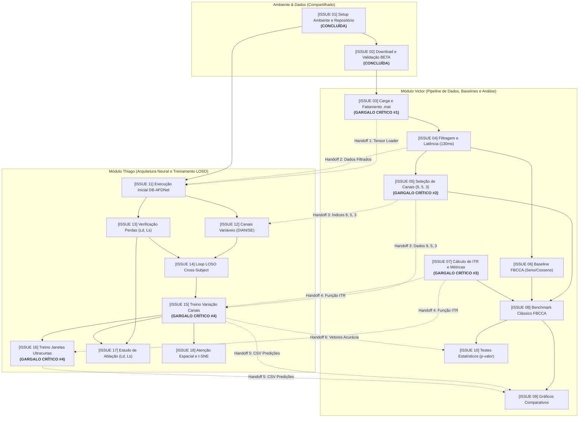

# Planejamento Operacional e Mapeamento de Dependências (Issues 01 a 18)

Este documento contém o catálogo completo das **18 issues** do projeto para a disciplina **OPT098**, acompanhado da **Matriz de Dependências**, do **Caminho Crítico** e dos **Pontos de Gargalo Inter-Módulos** entre Victor e Thiago para evitar bloqueios no fluxo de trabalho.

---

## 1. Mapeamento de Dependências e Análise de Caminho Crítico

### Diagrama de Fluxo e Handoffs entre Victor e Thiago

---

### 2. Quadro dos 4 Gargalos Críticos Inter-Módulos (Pontos de Bloqueio)

| Gargalo | Origem $\rightarrow$ Destino | Issues Envolvidas | Impacto se Atrasar | Ação Preventiva Imediata |
| :--- | :--- | :--- | :--- | :--- |
| **Gargalo #1** | **Victor $\rightarrow$ Thiago** | **ISSUE 03** bloqueia **ISSUE 11** | Thiago não consegue alimentar o repositório DB-AFDNet com os dados padronizados do BETA, travando o início da adaptação neural. | Victor deve priorizar a Issue 03 imediatamente e fechar o contrato do tensor: `[amostras, canais, tempo]`. |
| **Gargalo #2** | **Victor $\rightarrow$ Thiago** | **ISSUE 04 e 05** bloqueiam **ISSUE 12 e 15** | Thiago não pode parametrizar a entrada da rede com 5 e 3 canais nem rodar o treinamento cross-subject comparativo. | Definir a lista e ordem estrita dos canais: 9 (`Pz, PO5, PO3, POz, PO4, PO6, O1, Oz, O2`), 5 (`POz, PO3, PO4, Oz, O1`) e 3 (`O1, Oz, O2`). |
| **Gargalo #3** | **Victor $\rightarrow$ Thiago** | **ISSUE 07** bloqueia **ISSUE 15 e 16** | Se o cálculo de ITR for feito de formas diferentes, os resultados comparativos do artigo serão estatisticamente inválidos. | Victor implementa `compute_itr(...)` em `src/utils/metrics.py` com testes unitários compartilhados antes da Issue 15. |
| **Gargalo #4** | **Thiago $\rightarrow$ Victor** | **ISSUE 15 e 16** bloqueiam **ISSUE 09 e 10** | Victor fica de mãos atadas para produzir os gráficos finais (barras de ITR vs. canais) e os testes $t$ pareados para o artigo. | Thiago exporta os resultados consolidados em `experiments/results/` seguindo um formato padronizado de CSV (`sujeito, canais, janela, acuracia, itr`). |

---

### 3. Matriz de Dependência de Todas as Issues

| ID | Título da Issue | Responsável | Depende de | Bloqueia Diretamente | Grau de Risco |
| :---: | :--- | :---: | :---: | :---: | :---: |
| **01** | Setup do repositório e ambiente | Victor / Thiago | *Nenhuma* | 02, 11 | **Baixo (Concluída)** |
| **02** | Download e validação do BETA | Victor / Thiago | 01 | 03 | **Baixo (Concluída)** |
| **03** | Carregamento e fatiamento `.mat` | Victor | 02 | **04, 11 (Gargalo #1)** | **CRÍTICO** |
| **04** | Filtragem digital e latência (130ms) | Victor | 03 | 05, 06, 11 | **ALTO** |
| **05** | Seletor dinâmico de canais (9, 5, 3) | Victor | 04 | **08, 12, 15 (Gargalo #2)**| **CRÍTICO** |
| **06** | Classificador baseline FBCCA | Victor | 04 | 08 | **Médio** |
| **07** | Módulo de métricas e ITR | Victor | *Independente* | **08, 15, 16 (Gargalo #3)**| **ALTO** |
| **08** | Benchmark clássico FBCCA completo | Victor | 05, 06, 07 | 09, 10 | **Médio** |
| **09** | Gráficos comparativos e curvas | Victor | 08, **15, 16 (Gargalo #4)**| Artigo Final | **ALTO** |
| **10** | Testes de significância estatística | Victor | 08, **15 (Gargalo #4)** | Artigo Final | **ALTO** |
| **11** | Execução inicial do DB-AFDNet | Thiago | 01, **03, 04** | 12, 13 | **ALTO** |
| **12** | Parametrização para canais variáveis | Thiago | 11, **05** | 14 | **ALTO** |
| **13** | Validação das perdas $\mathcal{L}_d$ e $\mathcal{L}_s$ | Thiago | 11 | 14, 17 | **Médio** |
| **14** | Loop de validação cruzada LOSO | Thiago | 12, 13 | 15, 16 | **ALTO** |
| **15** | Treinamento com variação de canais | Thiago | 14, **05, 07** | **09, 10, 16, 17, 18** | **CRÍTICO** |
| **16** | Treinamento sob janelas ultracurtas | Thiago | 15, **07** | **09** | **ALTO** |
| **17** | Análise de ablação ($\mathcal{L}_d, \mathcal{L}_s$) | Thiago | 13, 15 | Artigo Final | **Médio** |
| **18** | Atenção espacial e mapa t-SNE | Thiago | 15 | Artigo Final | **Médio** |

---

## 4. Detalhamento das 18 Issues com Vínculos de Precedência

### Configuração Inicial de Ambiente (Compartilhada)

* **[ISSUE 01] Configuração do repositório, ambiente virtual e dependências base** `[CONCLUÍDA]`
  * **Responsável:** Victor / Thiago / Antigravity.
  * **Dependências:** Nenhuma.
  * **Bloqueia:** ISSUE 02, ISSUE 11.
  * **Descrição:** Criar o repositório base no GitHub com a estrutura de pastas (`data/`, `src/`, `models/`, `experiments/`, `notebooks/`, `scripts/`) e arquivo `.gitignore`. Criar o ambiente virtual (Python 3.10+) e o `requirements.txt` inicial contendo as bibliotecas essenciais (`torch`, `numpy`, `scipy`, `mne`, `matplotlib`, `seaborn`, `pandas`).
  * **Critério de Aceitação:** Repositório clonado e ambiente instalado com sucesso executando um script de teste simples (`python -c "import torch, scipy, mne; print('OK')"`).
  * **Status:** Concluída. Ambiente virtual `.venv` criado com Python 3.13, dependências instaladas via `requirements.txt` e scripts de validação (`verify_env.py` e teste inline) executados com sucesso gerando saída `OK`.

* **[ISSUE 02] Download e validação da integridade de amostras do dataset BETA** `[CONCLUÍDA]`
  * **Responsável:** Victor / Thiago / Antigravity.
  * **Dependências:** ISSUE 01.
  * **Bloqueia:** ISSUE 03.
  * **Descrição:** Baixar os dados do repositório do dataset BETA (pelo menos os 10 a 15 primeiros sujeitos para o pipeline de prototipação). Verificar se as variáveis e os tensores contidos nos arquivos `.mat` estão de acordo com o padrão documentado no artigo (dimensões de canais, tempo, blocos e condições de estímulo).
  * **Critério de Aceitação:** Arquivos armazenados no diretório local `data/raw/` e script de checagem confirmando o carregamento dos tensores de 40 alvos sem corrupção de dados.
  * **Status:** Concluída. Download de `S1.mat` a `S10.mat` + metadados executado via `scripts/download_beta.py` e validação dimensional executada via `scripts/verify_beta_data.py`. Todos os 10 sujeitos possuem tensores `(64, 750, 4, 40)` sem `NaN` ou `Inf`.

---

### Módulo Victor (Pipeline de Dados, Baselines e Análise de Canais)

* **[ISSUE 03] Implementação do módulo de carregamento e fatiamento dos arquivos `.mat`**
  * **Responsável:** Victor.
  * **Dependências:** ISSUE 02.
  * **Bloqueia:** ISSUE 04, **ISSUE 11 (Gargalo Crítico #1 para o Thiago)**.
  * **Criticidade:** **MÁXIMA**.
  * **Descrição:** Desenvolver um módulo em Python (`src/data/loader.py`) usando `scipy.io` para carregar as matrizes de EEG do BETA, extraindo os metadados de frequência, blocos e tentativas. Criar uma interface flexível para fatiar as épocas de acordo com o comprimento desejado (ex.: janelas de 0,2 s a 1,0 s).
  * **Critério de Aceitação:** Função `load_subject_data(subject_id, window_length)` retornando tensores NumPy `[amostras, canais, pontos_temporais]` prontos para uso.

* **[ISSUE 04] Implementação da filtragem digital e compensação de latência visual**
  * **Responsável:** Victor.
  * **Dependências:** ISSUE 03.
  * **Bloqueia:** ISSUE 05, ISSUE 06, ISSUE 11.
  * **Criticidade:** **ALTA**.
  * **Descrição:** Construir as rotinas de pré-processamento (`src/data/preprocessing.py`) aplicando filtro passa-faixa digital (Butterworth entre 8 Hz e 64 Hz) e filtro notch em 50 Hz para remoção de ruídos elétricos. Implementar o deslocamento temporal para compensar o atraso visual de aproximadamente 130 ms característico do dataset BETA.
  * **Critério de Aceitação:** Os sinais pré-processados devem apresentar espectro limpo com picos visíveis nas frequências estimuladas.

* **[ISSUE 05] Criação do módulo flexível de seleção de subconjuntos de canais**
  * **Responsável:** Victor.
  * **Dependências:** ISSUE 04.
  * **Bloqueia:** ISSUE 08, **ISSUE 12 e ISSUE 15 (Gargalo Crítico #2 para o Thiago)**.
  * **Criticidade:** **MÁXIMA**.
  * **Descrição:** Implementar um seletor dinâmico (`src/data/channels.py`) que permita configurar os eletrodos de entrada do modelo. O módulo deve suportar:
    1. 9 canais padrão (`Pz, PO5, PO3, POz, PO4, PO6, O1, Oz, O2`);
    2. 5 canais reduzidos (`POz, PO3, PO4, Oz, O1`);
    3. 3 canais mínimos (`O1, Oz, O2`).
  * **Critério de Aceitação:** Função ou flag de configuração que retorne os dados filtrados apenas para os índices de eletrodos especificados sem falhas de dimensão.

* **[ISSUE 06] Implementação do classificador baseline FBCCA**
  * **Responsável:** Victor.
  * **Dependências:** ISSUE 04.
  * **Bloqueia:** ISSUE 08.
  * **Criticidade:** Média.
  * **Descrição:** Desenvolver a implementação do algoritmo Filter Bank Canonical Correlation Analysis em `src/models/fbcca.py`. Criar a síntese dos gabaritos senoidais de referência para os 40 alvos (considerando fundamental e múltiplos harmônicos) e a decomposição em sub-bandas de filtros harmônicos.
  * **Critério de Aceitação:** Script executando o FBCCA puro sobre um bloco de teste e retornando a predição das classes sem necessidade de treinamento.

* **[ISSUE 07] Implementação do cálculo de ITR e métricas estatísticas**
  * **Responsável:** Victor.
  * **Dependências:** Independente (pode ser feita em paralelo às Issues 03-06).
  * **Bloqueia:** ISSUE 08, **ISSUE 15 e ISSUE 16 (Gargalo Crítico #3 para o Thiago)**.
  * **Criticidade:** **ALTA**.
  * **Descrição:** Implementar em `src/utils/metrics.py` a fórmula padrão da Taxa de Transferência de Informação (ITR em bits/min), considerando o tempo de estimulação, tempo de deslocamento de olhar (0,5 s) e o número total de alvos ($N=40$). Adicionar cálculo de acurácia média e desvio padrão.
  * **Critério de Aceitação:** Função `compute_itr(accuracy, window_time, n_targets=40, gaze_shift=0.5)` validada contra os valores teóricos apresentados na literatura.

* **[ISSUE 08] Benchmark clássico: Avaliação do FBCCA variando canais e janelas**
  * **Responsável:** Victor.
  * **Dependências:** ISSUE 05, ISSUE 06, ISSUE 07.
  * **Bloqueia:** ISSUE 09, ISSUE 10.
  * **Criticidade:** Média.
  * **Descrição:** Executar o pipeline do FBCCA variando: (1) os conjuntos de canais (9, 5 e 3 canais) e (2) as durações de janela (0,3 s, 0,5 s, 0,8 s e 1,0 s).
  * **Critério de Aceitação:** Tabela e arquivos `.csv` consolidados em `experiments/results/` com a acurácia e o ITR do FBCCA para cada sujeito testado em todas as combinações experimentadas.

* **[ISSUE 09] Geração de gráficos comparativos e curvas de desempenho**
  * **Responsável:** Victor.
  * **Dependências:** ISSUE 08, **ISSUE 15 e ISSUE 16 (Gargalo Crítico #4 vindo do Thiago)**.
  * **Criticidade:** **ALTA**.
  * **Descrição:** Construir scripts em Matplotlib/Seaborn para gerar gráficos profissionais: barras de ITR vs. número de canais, curvas de acurácia vs. comprimento da janela temporal, e distribuição de desempenho por sujeito.
  * **Critério de Aceitação:** Figuras exportadas em alta resolução (`.png`/`.pdf`) prontas para inclusão no relatório final.

* **[ISSUE 10] Execução de testes de significância estatística**
  * **Responsável:** Victor.
  * **Dependências:** ISSUE 08, **ISSUE 15 (Gargalo Crítico #4 vindo do Thiago)**.
  * **Criticidade:** **ALTA**.
  * **Descrição:** Aplicar testes estatísticos pareados (Student's paired t-test ou Wilcoxon com correção de Bonferroni) comparando o baseline clássico (FBCCA) com o modelo de aprendizado profundo (DB-AFDNet).
  * **Critério de Aceitação:** Obtenção de p-valores documentados em tabela indicando se as diferenças observadas entre modelos e entre contagens de canais são estatisticamente significativas ($p < 0,05$).

---

### Módulo Thiago (Arquitetura Neural, Treinamento/LOSO e Modelagem)

* **[ISSUE 11] Adaptação e execução inicial do repositório DB-AFDNet**
  * **Responsável:** Thiago.
  * **Dependências:** ISSUE 01, **ISSUE 03 e ISSUE 04 (Vindas do Victor)**.
  * **Bloqueia:** ISSUE 12, ISSUE 13, ISSUE 14.
  * **Criticidade:** **ALTA**.
  * **Descrição:** Integrar o código oficial do DB-AFDNet (`references/DBAFDNet`) aos scripts de carregamento padronizados desenvolvidos na Issue 03. Garantir a execução correta da FFT com zero-padding para extrair os componentes real e imaginário.
  * **Critério de Aceitação:** Execução bem-sucedida de um ciclo completo de forward-pass e backward-pass em GPU para uma época de teste.

* **[ISSUE 12] Parametrização da camada de entrada para suportar canais variáveis**
  * **Responsável:** Thiago.
  * **Dependências:** ISSUE 11, **ISSUE 05 (Vinda do Victor)**.
  * **Bloqueia:** ISSUE 14, ISSUE 15.
  * **Criticidade:** **ALTA**.
  * **Descrição:** Modificar a arquitetura do módulo DIAN (especificamente o bloco de atenção por canal `Channel-wise Attention` e convoluções iniciais) para que a rede aceite dinamicamente entradas com dimensões de canal $C=9$, $C=5$ e $C=3$ sem gerar erros de tensor.
  * **Critério de Aceitação:** Modelo instanciado e compilado com sucesso passando tensores de teste com tamanhos `[B, 9, F]`, `[B, 5, F]` e `[B, 3, F]`.

* **[ISSUE 13] Verificação das funções de perda com restrições ($\mathcal{L}_d$ e $\mathcal{L}_s$)**
  * **Responsável:** Thiago.
  * **Dependências:** ISSUE 11.
  * **Bloqueia:** ISSUE 14, ISSUE 17.
  * **Criticidade:** Média.
  * **Descrição:** Auditar e documentar as implementações da perda de similaridade inter-ramos ($\mathcal{L}_d$, baseada em norma $L_1$) e da perda de ortogonalidade intra-ramo ($\mathcal{L}_s$, baseada em norma de Frobenius) na função de perda composta do treinamento.
  * **Critério de Aceitação:** Logs de treino demonstrando a convergência gradual e simultânea das três perdas ($\mathcal{L}_c$, $\mathcal{L}_d$ e $\mathcal{L}_s$) durante as épocas.

* **[ISSUE 14] Implementação do loop de validação Leave-One-Subject-Out (LOSO)**
  * **Responsável:** Thiago.
  * **Dependências:** ISSUE 12, ISSUE 13.
  * **Bloqueia:** ISSUE 15, ISSUE 16.
  * **Criticidade:** **ALTA**.
  * **Descrição:** Estruturar o protocolo rigoroso de validação cruzada inter-sujeito (*cross-subject*): para $N$ sujeitos selecionados, treinar a rede em $N-1$ voluntários e avaliar as predições exclusivamente no sujeito deixado de fora, iterando sobre todos os sujeitos.
  * **Critério de Aceitação:** Script automatizado de validação LOSO salvando previsões e rótulos reais por participante em disco.

* **[ISSUE 15] Treinamento do DB-AFDNet com variação sistemática de canais**
  * **Responsável:** Thiago.
  * **Dependências:** ISSUE 14, **ISSUE 05 e ISSUE 07 (Vindas do Victor)**.
  * **Bloqueia:** **ISSUE 09 e ISSUE 10 (Gargalo Crítico #4 para o Victor)**, ISSUE 16, ISSUE 17, ISSUE 18.
  * **Criticidade:** **MÁXIMA**.
  * **Descrição:** Executar o treinamento LOSO do modelo neural para a janela temporal de 1,0 s utilizando: (1) 9 canais parieto-occipitais, (2) 5 canais e (3) 3 canais.
  * **Critério de Aceitação:** Pesos salvos em `models/` e relatórios de predição exportados em `.csv` para cada configuração de eletrodos.

* **[ISSUE 16] Treinamento do modelo neural sob janelas ultracurtas**
  * **Responsável:** Thiago.
  * **Dependências:** ISSUE 15, **ISSUE 07 (Vinda do Victor)**.
  * **Bloqueia:** **ISSUE 09 (Gargalo Crítico #4 para o Victor)**.
  * **Criticidade:** **ALTA**.
  * **Descrição:** Realizar os ensaios de treinamento e inferência avaliando a sensibilidade temporal do DB-AFDNet ao cortar o tamanho dos dados de entrada para 0,3 s, 0,5 s e 0,8 s (comparando com a janela completa de 1,0 s).
  * **Critério de Aceitação:** Métricas de acurácia e latência de inferência geradas para todas as durações temporais testadas exportadas em `.csv`.

* **[ISSUE 17] Análise de ablação das restrições atencionais e espectrais**
  * **Responsável:** Thiago.
  * **Dependências:** ISSUE 13, ISSUE 15.
  * **Bloqueia:** Artigo Final.
  * **Criticidade:** Média.
  * **Descrição:** Executar ensaios de ablação do modelo retirando componentes específicos (ex.: treinar sem a restrição de similaridade $\mathcal{L}_d$ ou sem a restrição de ortogonalidade $\mathcal{L}_s$) para validar a contribuição de cada mecanismo no cenário com poucos canais.
  * **Critério de Aceitação:** Relatório comparativo com dados de acurácia comprovando o impacto das restrições atencionais.

* **[ISSUE 18] Extração de pesos de atenção e visualização t-SNE**
  * **Responsável:** Thiago.
  * **Dependências:** ISSUE 15.
  * **Bloqueia:** Artigo Final.
  * **Criticidade:** Média.
  * **Descrição:** Implementar uma rotina para capturar as ativações dos mapas de atenção por canal (pesos atribuídos a cada eletrodo) e gerar gráficos de t-SNE das representações intermediárias para demonstrar a separabilidade entre as 40 classes.
  * **Critério de Aceitação:** Visualizações de mapas de calor de atenção espacial e dispersões t-SNE salvas em imagens para enriquecer a discussão dos resultados.